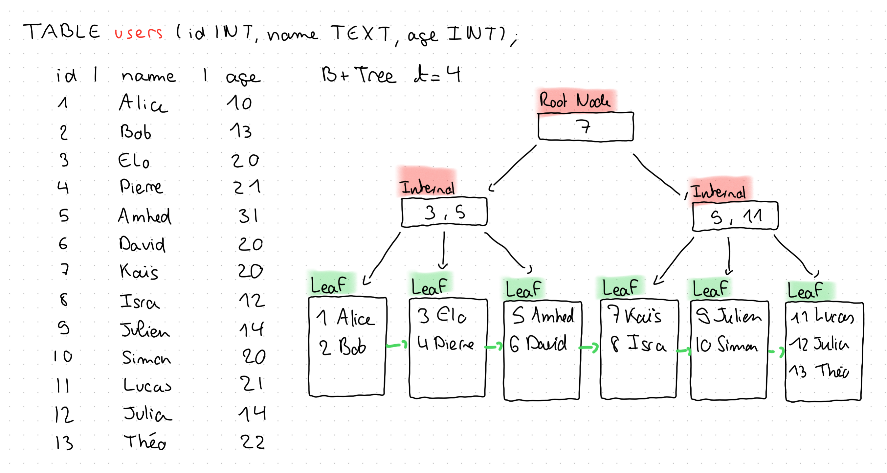

# Mini DB

MiniDB is a small relational database engine written in C11 inspired by [SQlite](https://www.sqlite.org/) and . It implements it's own binary file format, pager, B+Trees for persistent storage and a simple SQL parser.


## All Commands

### CREATE TABLE

```sql
CREATE TABLE users (id INT, name TEXT, age INT);
```

Creates a new table with the specified columns.


### INSERT INTO

```sql
INSERT INTO users VALUES (1, 'Ksamayo', 20);
```

Inserts a new row into a table.


### SELECT

```sql
SELECT * FROM users;
SELECT * FROM users WHERE id = 1;
```

Return all rows or a single row by ID.


### UPDATE

```sql
UPDATE users SET age = 23 WHERE id = 1;
```

Updates an existing row in a table.

- `WHERE id = integer` condition is required.
- `id` column cannot be modified.

### DELETE

```sql
DELETE FROM users WHERE id = 1;
```

Deletes a row identified by its ID.

- `WHERE id = integer` condition is required.

### REPL Commands

| Command         | Description                |
| --------------- | -------------------------- |
| `.help`         | Show all commands    |
| `.tables`       | List all tables            |
| `.schema users` | Show the schema of a table |
| `.exit`         | Exit MiniDB                |


## Usage/Examples

```sh
◄ 0s ◎ ./minidb database.db                                                                  □ mydb △ dev⎪●◦◌◦⎥ 13:57
MiniDB v0.1
Type .help for commands
minidb> CREATE TABLE users (id INT, name TEXT, age INT); 
OK
minidb> INSERT INTO users VALUES (1, 'Ksamayo', 20);
1 row inserted
minidb> INSERT INTO users VALUES (2, 'Elo', 20); 
1 row inserted
minidb> CREATE TABLE products (id INT, name TEXT, price INT);
OK
minidb> INSERT INTO products VALUES (1, 'Banana', 1);
1 row inserted
minidb> INSERT INTO products VALUES (2, 'Apple', 2);
1 row inserted
minidb> INSERT INTO products VALUES (3, 'Peach', 2);        
1 row inserted
minidb> SELECT * FROM users;
1 | Ksamayo | 20
2 | Elo     | 20
minidb> SELECT * FROM products WHERE id=2;
2 | Apple | 2
minidb> .tables 
users
products
minidb> .btree 
users:
page 2 leaf (2 keys) next=0: 1 2
products:
page 4 leaf (3 keys) next=0: 1 2 3
minidb> DELETE FROM products WHERE id=2; 
1 row deleted
minidb> SELECT * FROM products;
1 | Banana | 1
3 | Peach | 2
minidb> .btree
users:
page 2 leaf (2 keys) next=0: 1 2
products:
page 4 leaf (2 keys) next=0: 1 3
minidb> UPDATE users SET age=21 WHERE id=2;
1 row updated
minidb> SELECT * FROM users;
1 | Ksamayo | 20
2 | Elo     | 21
minidb> .exit 
```


## Architecture

### Code Structure

- **[pager.c](src/pager.c)** handles reading and writing on 4096-byte pages using `pread` and `pwrite`. Pages are loaded once when needed and stay in memory until the database is closed. Modified pages are tracked using a flags (dirty), while a free list allows unused pages to be reused.

- **[btree.c](src/btree.c)** manages the B+ tree used to store and find records by their id . Records are stored in linked leaf pages and  internal nodes used to guide the searches. It handles insertion, deletion, node splitting and rebalancing to keep the tree balanced.
This website display a very useful [B+ tree visualizer](https://roy2220.github.io/bptree/visualization).

- **[record.c](src/record.c)** validates table schemas and handles record serialization. Each integer is stored as a 64-bit value, while text is stored with a one-byte length prefix followed by its content.

- **[db.c](src/db.c)** manages tables and connects the different modules of the database. Each table has its own catalog page containing its name, schema and B+ tree root.

- **[parser.c](src/parser.c)** handles SQL tokenization and parsing, SQL parser is seperated from query execution on the database [db.c](src/db.c).

- **[main.c](src/main.c)** manages the CLI, user inputs and all commands.

### File format

MiniDB stores informations in **`4096 bytes pages`**. All multibytes integer use little-endian encoding.

### Page Types

There is 5 differents page types :
| Type | ID | Description |
|---|---:|---|
| Header | — | Stores global DB infos |
| Leaf | 1 | Stores records in the B+ tree |
| Internal | 2 | Stores keys and child pointers |
| Catalog | 3 | Stores table names and schemas |
| Free | 4 | Stores avaible pages for reuse |

### Header Page (Page 0)
Unused bits are reserved and zeroed.

| Offset | Size | Field |
| ---: | ---: | --- |
| 0 | 8 | Magic: `MINIDB\0\0` |
| 8 | 4 | Format version: 1 |
| 12 | 4 | Total pages, including page 0 |
| 16 | 4 | First catalog page, or 0 |
| 20 | 4 | Free list head, or 0 |

### Leaf Page (Type 1)
Leaf pages store records sorted by ID. All leaf pages are linked together to make sequential read easier.

Alls leaf page start with a **`16-byte`** header:


| Offset | Size | Field |
|---:|---:|---|
| 0 | 1 | Page type (`1`) |
| 1 | 1 | Unused for the moment |
| 2 | 2 | Number of keys (`u16`) |
| 4 | 4 | Next leaf page (`u32` or  `0` if none) |
| 8 | 4 | Unused for the moment |
| 12 | 2 | Record capacity (`u16`) |
| 14 | 2 | Unused for the moment |
| 16 | Variable | Record cells |

Each record cell contains:

| Relative offset | Size | Field |
|---:|---:|---|
| 0 | 8 | Record key (`i64`) |
| 8 | 2 | Actual record length (`u16`) |
| 10 | Variable | Fixed capacity record slot |

The slot capacity only depends on the schema and not the actual record size. It's allow to update records more easily without changing their allocated space.

For example, a table  users with `(id INT, name TEXT, age INT)` always uses 272-byte record slots however the name length.



### Internal Pages (Type 2)

Internal pages are used to store separtor keys and pointers to child pages ( leaf or internal ).
They help us to naviagte through the B+ tree.


| Offset | Size | Field |
|---:|---:|---|
| 0 | 1 | Page type (`2`) |
| 1 | 1 | Unused for the moment |
| 2 | 2 | Number of keys (`u16`) |
| 4 | 8 | Unused for the moment |
| 12 | 2 | Record capacity field (`u16`, unused) |
| 14 | 2 | Unused for the moment |
| 16 | 4 | First child page (`u32`) |
| 20 | Variable | Separator and child pairs |


Alls entries after the first child contains:

| Relative offset | Size | Field |
|---:|---:|---|
| 0 | 8 | Separator key (`i64`) |
| 8 | 4 | Right child page (`u32`) |

Each seperator is the smallest key in his right subtree. 

An internal page can hold at most **339 keys and 340 child pointers**. So the B+ tree has a minimum degree of **t = 170**, meaning non root internal nodes must contain at least **169 keys** (170 children).

### Catalog Pages (Type 3)

Each table has a catalog page containing its name, schema and current B+ tree root.

| Offset | Size | Field |
|---:|---:|---|
| 0 | 1 | Page type (`3`) |
| 1 | 3 | Unused for the moment |
| 4 | 4 | Next catalog page (`u32`, `0` if none) |
| 8 | 4 | B+ tree root page (`u32`) |
| 12 | 2 | Number of columns (`u16`) |
| 14 | 2 | Unused for the moment |
| 16 | 32 | Table name |
| 48 | Variable | Column definitions |

Each column definition takes 33 bytes:

| Relative offset | Size | Field |
|---:|---:|---|
| 0 | 32 | column name |
| 32 | 1 | Column type (`1 = INT`, `2 = TEXT`) |

A table can have at most 8 columns with id = INT required as the first column.

### Free Pages (Type 4)

When a page is no longer used, it is added to a linked free list so it can be reused later.

| Offset | Size | Field |
|---:|---:|---|
| 0 | 1 | Page type (`4`) |
| 1 | 3 | Unused for the moment |
| 4 | 4 | Next free page (`u32`, `0` if none) |
| 8 | 4088 | Unused |


The first Page (Page 0) can't be freed. Reusing pages avoid the file to growth for nothing. 


## Next useful features

### Better SQL Queries

For now, the `WHERE` condition is limited to `id = integer`.

The first step would be to add **range queries**, such as:

```sql
SELECT * FROM users WHERE id > 100;
```

Then, support **logical operators** like `AND`, `OR` and `NOT` to allow more complex conditions:

```sql
SELECT * FROM users WHERE id > 100 AND NOT id = 120;
```

Adding **`ORDER BY`** and **`LIMIT`** would also be useful thanks to B+ tree implementaion would probably be easy.

The final goal is to have more complex SQL queries but this would require a lot of works on the SQL parser and queries execution system.


###  LRU cache

For the moment all used pages stay in the memory until the databse is exited. This create a big issue memory usage can grow as more pages are readed.


The goal is to implement a **fixed size page cache** with LRU eviction policy.

Dirty pages will be written before eviction.

It's a very complex domain but have real impact on the project's performances.


### Index on others attrs

Currently, the database only uses an index on the id column. This makes looking up records by ID very fast but searching with other columns requires scanning the entire table.

The goal is to support multiple indexes using multiple B+ trees, allowing faster searches on columns other than the id.

For example :

```sql 

CREATE INDEX index_users_age ON users(age);

SELECT * FROM users WHERE age = 20;


```

Some difficulties:

- **Duplicate values**: primary key are unique by definition but records can share the same indexed value.
- **Index maintenance**: INSERT, UPDATE, DELETE also update the affected indexes.

Implementing it on INT would be more easy than TEXT attrs. 

## Acknowledgements

 - [Awesome README](https://github.com/matiassingers/awesome-readme)
 - [SQLite Documentation](https://www.sqlite.org/docs.html)
 - [Build your own X](https://github.com/codecrafters-io/build-your-own-x)
 - [Build your own Database in C]


